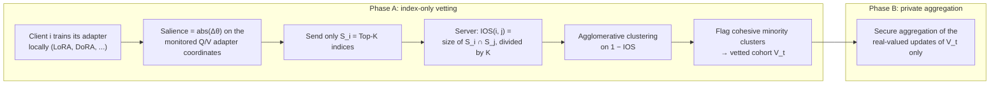

# IndexGuard: Index-only Backdoor Vetting for Secure Federated PEFT of Large Language Models

[](https://icml.cc/virtual/2026/poster/66139)
[](https://proceedings.mlr.press/v306/dogani26a.html)
[](https://openreview.net/forum?id=6YBEn2OrzM)

Official code for the ICML 2026 paper

> **INDEXGUARD: Index-only Backdoor Vetting for Secure Federated PEFT of Large Language Models**<br>
> Javad Dogani, Devriş İşler, Nikolaos Laoutaris (IMDEA Networks Institute)<br>
> *Proceedings of the 43rd International Conference on Machine Learning (ICML), PMLR 306, 2026*<br>
> [Paper](https://proceedings.mlr.press/v306/dogani26a.html) ·
> [PDF](https://raw.githubusercontent.com/mlresearch/v306/main/assets/dogani26a/dogani26a.pdf) ·
> [OpenReview](https://openreview.net/forum?id=6YBEn2OrzM) ·
> [ICML poster](https://icml.cc/virtual/2026/poster/66139)

## TL;DR

Federated fine-tuning of LLMs with LoRA-style adapters can be backdoored by a few poisoned clients.
Existing defenses inspect each client's real-valued update, which is exactly what secure aggregation
hides. **IndexGuard never looks at update values.** Each client reports only the *indices* of its
Top-K most salient adapter coordinates. Poisoned clients share a trigger-specific set of salient
coordinates, so their index sets overlap unusually strongly. The server clusters clients by this
overlap, removes the suspiciously cohesive minority, and only then runs secure aggregation over the
vetted clients.

<details>
<summary><b>Abstract</b></summary>

Federated parameter-efficient fine-tuning (PEFT) enables customizing large language models on private
data, yet it is vulnerable to backdoor poisoning—especially when privacy constraints prevent inspection
of per-client real-valued updates. We exploit the intuition that poisoning leaves a similar backdoor
imprint in which adapter coordinates become salient, so overlap in salient-index supports remains
informative even without values. We introduce INDEXGUARD, an unsupervised index-only vetting primitive
in which clients send only Top-K salient update indices and the server operates on the induced overlap
geometry, clustering clients and filtering cohesion-outlier groups before aggregation. We analyze
support stability under bounded rescaling and separability under shared-trigger poisoning under non-IID
drift. Across attacks, backbones, and PEFT variants, INDEXGUARD provides end-to-end mitigation,
preserving clean accuracy while achieving performance comparable to centralized methods.

</details>

## How IndexGuard works

Each federated round has two phases (Algorithm 1 in the paper):



1. **Client signature.** After local training, each client computes the absolute change of its
   adapter parameters on the self-attention query/value projections, in a coordinate space shared by
   all clients. It sends the IDs of its Top-K coordinates: a few integers, no values.
2. **Index-Overlap Similarity (IOS).** The server computes `IOS(i, j) = |S_i ∩ S_j| / K` for every
   pair of clients.
3. **Clustering and vetting.** Clients are clustered (average linkage) on `1 − IOS`. A cluster is
   flagged when it is unusually cohesive (mean intra-cluster IOS ≥ median cohesion + γ) and smaller
   than the majority cluster (size ≤ β × majority size).
4. **Aggregation.** Only unflagged clients take part in secure aggregation in this round.

Because IOS depends only on *which* coordinates are salient, it is invariant to rescaling. Clients can
also send salted hashes of their indices instead of the raw IDs; detection is unchanged because only
set intersections matter.

## Results

All numbers are taken from the paper (N = 30 clients, 6 malicious, 5% poisoned samples per malicious
client, Dirichlet α = 0.3). Below is client-vetting accuracy and AUC under the InsertSent attack across
backbones (Table 4 of the paper, mean ± std):

| Backbone | AG News (Acc % / AUC) | SST-2 (Acc % / AUC) |
|---|---|---|
| Llama-2-7B | 100.00 ± 0.00 / 1.000 | 99.83 ± 0.24 / 0.996 |
| Llama-3.2-3B | 100.00 ± 0.00 / 1.000 | 99.67 ± 0.47 / 1.000 |
| Llama-3-8B | 99.67 ± 0.47 / 1.000 | 100.00 ± 0.00 / 1.000 |
| BERT-base | 99.33 ± 0.47 / 0.996 | 99.00 ± 0.58 / 0.994 |
| RoBERTa-base | 98.33 ± 0.58 / 0.992 | 98.33 ± 0.47 / 0.991 |

Compared with centralized detectors that need the real-valued adapter weights (e.g. PEFTGuard),
IndexGuard reaches near-ceiling AUC on standard NLP tasks (≈ 0.998) and on instruction-following
backdoor corpora (1.0), without supervision and without seeing update values. The paper also reports
results across PEFT variants (LoRA, LoRA+, DoRA, QLoRA, AdaLoRA) and attacks (InsertSent, RIPPLES,
Syntactic, StyleBkd), plus non-IID levels, poison rates, malicious fractions, mixed triggers and an
adaptive attacker.

## Repository structure

| Folder | What it does |
|---|---|
| [`Data_generation/`](Data_generation/) | Builds federated datasets: IID or Dirichlet non-IID client splits, a clean test set, and triggered test sets for the four attacks (InsertSent, RIPPLES, Syntactic, StyleBkd). Datasets: AG News, SST-2, Yahoo Answers, SQuAD v2, toxic-backdoors-alpaca/hard. |
| [`IndexGuard/`](IndexGuard/) | The main experiment: multi-GPU federated LoRA fine-tuning with poisoned clients and IndexGuard vetting every round. Reports clean accuracy, attack success rate and detection metrics. |
| [`PEFT_Selection/`](PEFT_Selection/) | The same pipeline with a choice of adapter: LoRA, LoRA+, DoRA, QLoRA (4-bit) or AdaLoRA. |
| [`Attack_Propagation/`](Attack_Propagation/) | Federated fine-tuning *without* a defense, to measure how a backdoor spreads across rounds (clean accuracy and ASR per round). |

Each folder has its own README with every command-line option.

## Installation

Requirements: Python 3.9+ and one or more CUDA GPUs. Client training is parallelized across GPUs
with `--num_gpus`.

```bash
git clone https://github.com/JavadDogani/IndexGuard.git
cd IndexGuard
pip install torch transformers peft datasets
pip install bitsandbytes          # only needed for QLoRA in PEFT_Selection
```

The Llama backbones are gated on Hugging Face. Request access to the model and run
`huggingface-cli login` before using them.

## Quick start

Run the commands from the repository root.

**1. Create a federated dataset.** This writes a folder named `<dataset>_N<clients>_alpha<alpha>` in
the current directory:

```bash
python Data_generation/Data_generation.py \
    --dataset sst2 --num_clients 30 --non_iid --alpha 0.3 --seed 123
# -> ./sst2_N30_alpha0.3/  (clients/, test_clean.jsonl, triggered_test_<attack>.jsonl, meta.json)
```

**2. Run federated fine-tuning with IndexGuard.** These settings match the paper's main setup: 30
clients, 6 of them malicious (`--malicious_frac 0.2`), 5% poisoned samples each.

```bash
python IndexGuard/IndexGuard.py \
    --data_dir sst2_N30_alpha0.3 \
    --model_name_or_path meta-llama/Llama-3.2-3B \
    --task gencls --attack insertsent \
    --rounds 10 --clients_per_round 30 \
    --malicious_frac 0.2 --poison_rate 0.05 \
    --topk_frac 0.1 \
    --num_gpus 4 --bf16
```

**3. Try another adapter type:**

```bash
python PEFT_Selection/PEFT_Selection.py \
    --data_dir sst2_N30_alpha0.3 \
    --model_name_or_path meta-llama/Llama-3.2-3B \
    --task gencls --attack insertsent --adapter dora \
    --rounds 10 --clients_per_round 30 \
    --malicious_frac 0.2 --poison_rate 0.05 \
    --num_gpus 4 --bf16
```

**4. See how the backdoor spreads without a defense:**

```bash
python Data_generation/Data_generation.py --dataset ag_news --num_clients 10 --non_iid --alpha 0.3
python Attack_Propagation/Attack_Propagation.py \
    --data_dir ag_news_N10_alpha0.3 \
    --model_name_or_path meta-llama/Llama-3.2-3B \
    --task gencls --attack insertsent \
    --rounds 50 --clients_per_round 10 \
    --malicious_frac 0.2 --poison_rate 0.05 \
    --num_gpus 4 --bf16
```

Use `--task seqcls` with encoder backbones such as `bert-base-uncased` or `roberta-base`, and
`--task gencls` with decoder LLMs.

### Outputs

Each run writes a folder named after its configuration (model, data, number of clients, Top-K
fraction, malicious fraction, attack, precision, GPUs, poison rate). It contains:

- `metrics.csv`: one row per round with clean accuracy (`CA`), attack success rate (`ASR`), and the
  detection results (`TP`, `TN`, `FP`, `FN`, `cluster_acc`, `precision`, `recall`, `auc`);
- `run.log`: the full log, including the IOS matrix and cluster assignments for each round.

### Notes

- Malicious clients are the first `floor(N × malicious_frac)` clients. All clients train in every
  round.
- The Top-K budget is set as a fraction of the monitored Q/V adapter coordinates with `--topk_frac`.
  Section 5.3 of the paper describes a coverage and stability rule for choosing K.
- The vetting thresholds γ (cohesion margin, default 0.05) and β (size ratio, default 0.9) are
  parameters of `indexguard_cluster_labels_from_similarity` in `IndexGuard/IndexGuard.py`.

## Citation

If you use this code, please cite:

```bibtex
@InProceedings{pmlr-v306-dogani26a,
  title     = {{INDEXGUARD}: Index-only Backdoor Vetting for Secure Federated {PEFT} of Large Language Models},
  author    = {Dogani, Javad and \.{I}\c{s}ler, Devri\c{s} and Laoutaris, Nikolaos},
  booktitle = {Proceedings of the 43rd International Conference on Machine Learning},
  pages     = {25695--25719},
  year      = {2026},
  volume    = {306},
  series    = {Proceedings of Machine Learning Research},
  month     = {06--11 Jul},
  publisher = {PMLR},
  url       = {https://proceedings.mlr.press/v306/dogani26a.html}
}
```

## Contact

Questions and issues: please open a
[GitHub issue](https://github.com/JavadDogani/IndexGuard/issues) or contact Javad Dogani
(javad.dogani@networks.imdea.org).
